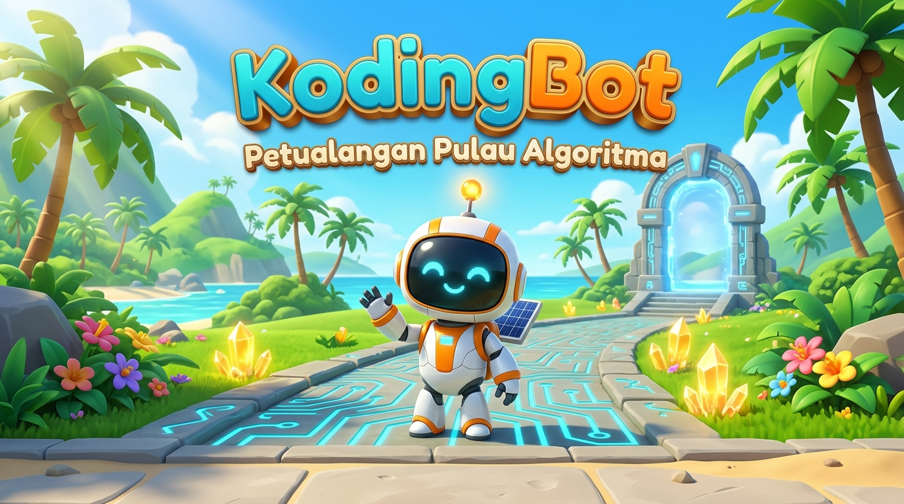
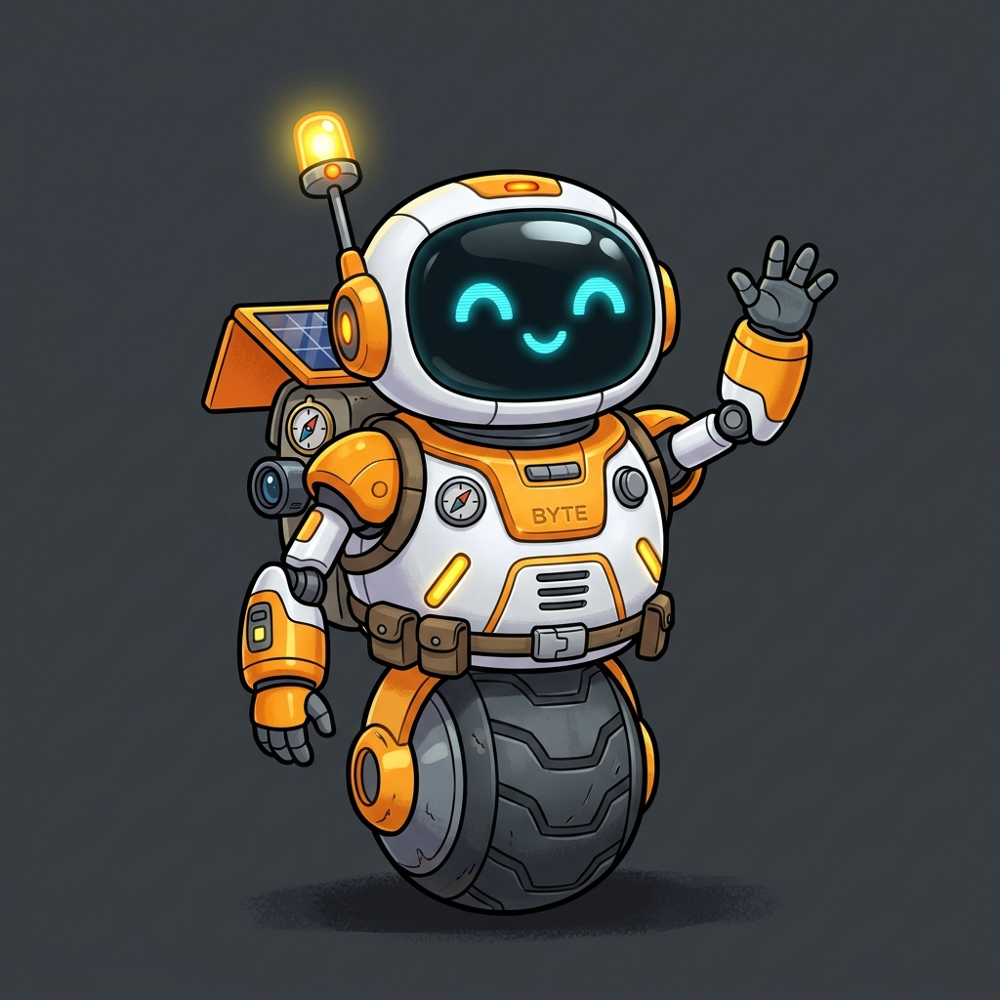

<p align="center">
  
</p>

<h1 align="center">🤖 KodingBot: Petualangan Pulau Algoritma</h1>

<p align="center">
  <strong>Game Edukasi Interaktif Berpikir Komputasional & Dasar Pemrograman untuk Siswa SD/MI</strong>
</p>

<p align="center">
  <em>"Rangkai Kodenya, Pecahkan Teka-tekinya, Selamatkan Pulau Algoritma!"</em>
</p>

<p align="center">
  <a href="#-tentang-game"></a>
  <a href="#-kurikulum--pedagogi"></a>
  <a href="#-peta-zona--30-level"></a>
  <a href="#-teknologi"></a>
  <a href="#-kredit--pengembang"></a>
</p>

---

## 📖 Daftar Isi
- [🌟 Sekilas Pandang](#-sekilas-pandang)
- [🎯 Capaian Pembelajaran & Pedagogi](#-capaian-pembelajaran--pedagogi)
- [🗺️ Peta Zona & 30 Level Progresif](#️-peta-zona--30-level-progresif)
- [🧩 Mekanisme Permainan & Kartu Balok](#-mekanisme-permainan--kartu-balok)
- [✨ Fitur-Fitur Unggulan](#-fitur-fitur-unggulan)
- [⌨️ Pintasan Papan Ketik (Lab Komputer)](#️-pintasan-papan-ketik-lab-komputer)
- [🛠️ Arsitektur & Teknologi](#️-arsitektur--teknologi)
- [🚀 Panduan Menjalankan Game](#-panduan-menjalankan-game)
- [🏫 Panduan Guru & Penggunaan di Kelas](#-panduan-guru--penggunaan-di-kelas)
- [📂 Struktur Direktori](#-struktur-direktori)
- [👨‍💻 Kredit & Pengembang](#-kredit--pengembang)
- [📄 Lisensi](#-lisensi)

---

## 🌟 Sekilas Pandang

**KodingBot: Petualangan Pulau Algoritma** (*KodingBot: Algorithm Island Adventure*) adalah media pembelajaran interaktif berbasis game (*Digital Educational Game*) yang dirancang khusus untuk mengenalkan konsep **Berpikir Komputasional (*Computational Thinking*)** dan logika pemrograman dasar kepada anak-anak usia 7–12 tahun (Siswa SD/MI).

### 📖 Kisah Latar (Narrative Premise)
> Di sebuah pulau tropis terpencil yang menyimpan rahasia teknologi ramah lingkungan purba, sebuah badai petir dahsyat melumpuhkan sistem memori robot penjelajah bertenaga surya bernama **Byte**.
> 
> Kehilangan memori navigasi membuat Byte tidak dapat melangkah sendiri. Pemain bertindak sebagai **Insinyur Robotika Cilik** yang menyusun barisan kode instruksi visual untuk menuntun Byte mengumpulkan kristal energi, mengaktifkan saklar jembatan kuno, dan mencapai stasiun pemancar sinyal penyelamat agar Byte dapat kembali pulang!

<p align="center">
  
  <br>
  <em>Halo! Aku <strong>Byte</strong>, robot penjelajah bertenaga surya yang siap diprogram!</em>
</p>

---

## 🎯 Capaian Pembelajaran & Pedagogi

Game ini diselaraskan dengan **Mata Pelajaran Informatika & Berpikir Komputasional** pada **Kurikulum Merdeka**:
- **Target Sasaran:** Siswa SD / MI Kelas 3–6 (Fase B & C).
- **Pendekatan:** *Constructivist Learning* & *Learning by Doing* dengan antarmuka balok visual tanpa beban pengetikan sintaks.
- **Prinsip Bebas Hukuman (*Growth Mindset*):** Tidak ada konsep *Game Over* atau pengurangan nyawa. Kesalahan diarahkan secara reflektif melalui proses *debugging*.

### 4 Pilar Berpikir Komputasional yang Dilatih:

| Pilar CT | Implementasi dalam KodingBot |
| :--- | :--- |
| **Dekomposisi** | Siswa memecah rute labirin panjang menjadi segmen langkah demi langkah yang terukur. |
| **Pengenalan Pola** | Siswa mengenali urutan gerakan berulang dan menyederhanakannya memakai balok `LOOP`. |
| **Abstraksi** | Siswa mengabaikan detail fisik lingkungan dan fokus pada grid ubin serta koordinat relatif arah robot. |
| **Algoritma** | Siswa menyusun urutan logis instruksi (*sequencing*) dan logika percabangan (*conditional if/else*). |

---

## 🗺️ Peta Zona & 30 Level Progresif

Tersedia **30 level orisinal** yang terbagi ke dalam **5 zona tematik**, dengan kurva kesulitan bertahap yang ramah anak:

```
[Zona 1: Pantai Fondasi] ──▶ [Zona 2: Teluk Rintangan] ──▶ [Zona 3: Lembah Perulangan]
                                                                     │
[Zona 5: Kuil Master Algoritma] ◀── [Zona 4: Hutan Sensor Logika] ───┘
```

| Zona | Level | Fokus Pembelajaran | Elemen Utama |
| :---: | :---: | :--- | :--- |
| **Zona 1: Pantai Fondasi** | 1 – 6 | *Sequencing* & Orientasi Spasial 90° | Garis lurus, belokan tunggal & ganda, kristal awal |
| **Zona 2: Teluk Rintangan** | 7 – 12 | Lompatan Celah, Saklar & Jembatan | Parit air, tebing batu, saklar aktivasi jembatan |
| **Zona 3: Lembah Perulangan** | 13 – 18 | Pengenalan Pola & *Looping* (Perulangan) | Balok C-Block `LOOP` (2x, 3x, 4x), efisiensi kode (*Par*) |
| **Zona 4: Hutan Sensor Logika** | 19 – 24 | Percabangan Bersyarat (*If-Else*) | Sensor rintangan di depan robot, jalur adaptif |
| **Zona 5: Kuil Master Algoritma** | 25 – 30 | Rekapitulasi & Algoritma Tingkat Lanjut | Kombinasi Loop tersarang, saklar ganda, tantangan master |

---

## 🧩 Mekanisme Permainan & Kartu Balok

### 1. Palet Kartu Perintah
Pemain menyusun program menggunakan balok instruksi warna-warni yang intuitif:

* 🟢 **MAJU (Forward):** Menggerakkan Byte 1 langkah ke petak di depannya.
* 🔵 **PUTAR KIRI (Turn Left):** Memutar hadap Byte 90° berlawanan arah jarum jam.
* 🔵 **PUTAR KANAN (Turn Right):** Memutar hadap Byte 90° searah jarum jam.
* 🟣 **LOMPAT (Jump):** Melompati rintangan celah atau air rendah dan mendarat di petak berikutnya.
* 🟠 **LOOP (Perulangan C-Block):** Membungkus instruksi untuk diulang beberapa kali (2x, 3x, 4x), melatih prinsip *DRY (Don't Repeat Yourself)*.
* 🔴 **JIKA RINTANGAN (Conditional E-Block):** Memeriksa sensor rintangan: jika ada hambatan lakukan aksi A, jika aman lakukan aksi B.

### 2. Sistem Evaluasi 3 Bintang (3-Star Mastery)

```
⭐⭐⭐ Bintang 3: Tuntas Misi + Semua Kristal + Target Par Kode (Master)
 ⭐⭐  Bintang 2: Tuntas Misi + Seluruh Kristal Energi Terkumpul
  ⭐   Bintang 1: Berhasil mencapai Stasiun Pendaratan Akhir
```

> [!TIP]
> **Apa itu Target Par?**
> *Target Par* adalah batas jumlah kartu instruksi paling efisien untuk menyelesaikan sebuah level. Mengajarkan siswa bahwa program yang baik bukan hanya berjalan benar, tetapi juga efisien dan rapi.

---

## ✨ Fitur-Fitur Unggulan

- 👁️ **Visual Code Tracing Real-Time:** Saat program dijalankan, kursor cahaya menyorot kartu yang sedang aktif seirama dengan langkah Byte di layar. Siswa memahami hubungan nyata antara kode dan aksi.
- 👣 **Mode 1 Langkah (Step-by-Step Tracing):** Tombol khusus untuk mengeksekusi instruksi satu per satu. Memudahkan anak meneliti jalannya algoritma saat melakukan *debugging*.
- 🎵 **Procedural Web Audio API Synthesizer:** Musik latar tropis yang riang dan efek suara taktil (klik mekanik, langkah servo hidrolik, *chime* kristal, fanfare) disintesis secara dinamis dalam peramban. **100% bebas lag & tanpa membebani bandwidth sekolah!**
- 📱 **Desain Responsif 3-Kolom Studio:** Tampilan adaptif untuk layar monitor komputer lab 16:9, laptop, Chromebook, tablet sentuh, maupun ponsel pintar.
- 🔓 **Mode Bebas untuk Pembelajaran:** Seluruh 30 level dapat langsung dipilih dan diakses guru tanpa harus menyelesaikan level sebelumnya secara berurutan, memudahkan penyesuaian materi ajar.
- 🔄 **Fitur Lab Reset Rombel:** Fasilitas khusus bagi guru untuk mereset seluruh skor/bintang lokal sebelum sesi rombongan belajar (rombel) kelas berikutnya dimulai.

---

## ⌨️ Pintasan Papan Ketik (Lab Komputer)

Untuk mendukung kecepatan belajar di laboratorium komputer sekolah tanpa perlu bergantung penuh pada tetikus (*mouse*):

| Tombol | Fungsi Aksi |
| :---: | :--- |
| <kbd>1</kbd> s.d. <kbd>6</kbd> | Memasukkan kartu perintah dari palet secara cepat |
| <kbd>Spasi</kbd> / <kbd>Enter</kbd> | **Jalankan Program** (*Run*) |
| <kbd>T</kbd> | **1 Langkah** (*Step Tracing*) |
| <kbd>R</kbd> | **Reset Posisi Robot** (*Debug Route*) |
| <kbd>H</kbd> | Buka Jendela **Petunjuk Level** (*Hint*) |
| <kbd>S</kbd> | Ubah Kecepatan Langkah Robot (1x / 2x / 0.5x) |
| <kbd>M</kbd> | Bisukan / Nyalakan Suara (*Mute*) |
| <kbd>F</kbd> | Masuk / Keluar Mode **Layar Penuh** (*Fullscreen*) |
| <kbd>Esc</kbd> | Menutup jendela modal / pop-up aktif |

---

## 🛠️ Arsitektur & Teknologi

Game dibangun menggunakan teknologi peramban web murni (*pure vanilla stack*) tanpa dependensi perpustakaan berat, memastikan performa instan di komputer dengan spesifikasi terbatas:

```
┌────────────────────────────────────────────────────────┐
│                      HTML5 Canvas                      │
│             (960 x 640 Responsive Engine)              │
├────────────────────────────────────────────────────────┤
│                 Modular Vanilla ES6 JS                 │
│  ├── main.js             : Game Loop & Lifecycle       │
│  ├── interpreter/        : Code Runner & C-Block Loops │
│  ├── grid/               : TileMap & Layer Renderer    │
│  ├── entities/           : Byte Robot State & Physics  │
│  ├── audio/              : Procedural Audio Synth      │
│  └── ui/                 : Touch & Studio Controller   │
├────────────────────────────────────────────────────────┤
│           Web Audio API Prosedural (0ms Latency)       │
├────────────────────────────────────────────────────────┤
│        Modern CSS3 Grid/Flexbox UI (Taktil 3D)         │
└────────────────────────────────────────────────────────┘
```

---

## 🚀 Panduan Menjalankan Game

KodingBot menggunakan modul standar **JavaScript ES6 (`import`/`export`)**, sehingga memerlukan *local web server* ringan agar fitur modul berjalan lancar:

### Opsi 1: Menggunakan Laragon / XAMPP (Sangat Direkomendasikan di Sekolah)
1. Letakkan folder `kodingbot` ke dalam direktori root server:
   - Laragon: `C:\laragon\www\kodingbot`
   - XAMPP: `C:\xampp\htdocs\kodingbot`
2. Jalankan Apache dari panel kontrol Laragon / XAMPP.
3. Buka peramban (Chrome / Edge / Firefox) dan kunjungi:
   ```
   http://localhost/kodingbot/
   ```

### Opsi 2: Menggunakan Ekstensi VS Code (Live Server)
1. Buka folder proyek ini di **Visual Studio Code**.
2. Pasang ekstensi **Live Server** (oleh Ritwick Dey).
3. Klik kanan pada file [`index.html`](file:///c:/laragon/www/kodingbot/index.html) lalu pilih **"Open with Live Server"**.

### Opsi 3: Menggunakan Python Web Server (Terminal)
Jika komputer sudah terpasang Python:
```bash
# Masuk ke direktori proyek
cd c:\laragon\www\kodingbot

# Jalankan HTTP server bawaan Python
python -m http.server 8080
```
Buka peramban di `http://localhost:8080`.

---

## 🏫 Panduan Guru & Penggunaan di Kelas

### Rekomendasi Skenario Pembelajaran (1 Pertemuan = 2 x 35 Menit):
1. **Apersepsi (10 Menit):** 
   - Guru membuka Level 1 di layar proyektor kelas.
   - Diskusikan arah hadap Byte dan bagaimana komputer membaca perintah secara urut (*sekuensial*).
2. **Eksplorasi Terbimbing (20 Menit):** 
   - Siswa mencoba Zona 1 (Level 1–6) di perangkat masing-masing.
   - Tekankan bahwa jika robot menabrak, itu adalah bagian alami dari *debugging*, bukan kegagalan!
3. **Tantangan Mandiri & Efisiensi (30 Menit):** 
   - Siswa melanjutkan ke Zona 2 atau Zona 3.
   - Dorong siswa meraih Bintang 3 dengan memperhatikan batas *Par Kartu*.
4. **Refleksi & Penutup (10 Menit):** 
   - Tanyakan kepada siswa: *"Mengapa balok LOOP membuat langkah kita lebih hemat dan rapi?"*

### Mereset Data untuk Kelas Baru:
Buka menu **TENTANG & KREDIT** dari menu utama, lalu klik tombol merah **"Hapus / Reset Seluruh Bintang"** pada panel Pengaturan Guru.

---

## 📂 Struktur Direktori

```text
kodingbot/
├── index.html                  # Halaman utama & struktur UI modal
├── README.md                   # Dokumentasi resmi proyek
├── GAME_IDENTITY.md            # Metadata resmi & instansi pengembang
├── GAME_DESIGN.md              # Game Design Document (GDD)
├── ART_DIRECTION.md            # Panduan palet warna & grafis
├── UI_UX_SPEC.md               # Spesifikasi antarmuka & ergonomi
├── QA_REPORT.md                # Laporan verifikasi pengujian sistem
├── assets/
│   ├── css/
│   │   └── main.css            # Gaya tema neon eco-tech & tombol 3D
│   └── images/
│       ├── branding/           # Cover landscape 16:9 & square icon
│       ├── characters/         # Sprite & ilustrasi robot Byte
│       ├── backgrounds/        # Panorama pulau & latar menu
│       ├── props/              # Kristal energi & collectible
│       └── tiles/              # Ubin jalan, air, rumput, portal, saklar
└── src/
    ├── config.js               # Konfigurasi konstan, koordinat & ubin
    ├── main.js                 # Orkestrasi game & kanvas 60 FPS
    ├── audio/
    │   └── soundManager.js     # Web Audio API Synthesizer (BGM & SFX)
    ├── core/
    │   ├── assetManager.js     # Prapemuat (preloader) aset gambar
    │   └── stateManager.js     # Manajemen state & penyimpanan localStorage
    ├── entities/
    │   └── byteRobot.js        # Fisika gerak, rotasi & animasi Byte
    ├── grid/
    │   └── tileMap.js          # Rendering ubin interaktif & hover inspector
    ├── interpreter/
    │   └── codeRunner.js       # Interpreter perintah visual & tracing
    ├── levels/
    │   └── levelData.js        # Basis data 30 level & 5 zona tematik
    └── ui/
        └── uiController.js     # Kontroler UI, palet kartu & antrean blok
```

---

## 👨‍💻 Kredit & Pengembang

* **Pengembang Utama / Game Producer:**  
  **Riskhi Ilham Hidayat**  
  *Pengembang Teknologi Pembelajaran*
* **Instansi:**  
  **Balai Besar Guru dan Tenaga Kependidikan (BBGTK) Provinsi Jawa Tengah**  
  Kementerian Pendidikan Dasar dan Menengah Republik Indonesia
* **Tahun Rilis:** 2026
* **Kategori:** Media Pembelajaran Interaktif (MPI) / Game Edukasi Digital

---

## 📄 Lisensi

Hak Cipta © 2026 **BBGTK Provinsi Jawa Tengah & Pengembang**.  
Dikembangkan untuk tujuan pendidikan, peningkatan kompetensi literasi digital, dan penguatan berpikir komputasional bagi guru dan peserta didik di Indonesia.

<p align="center">
  <sub>Dibuat dengan ❤️ dan dedikasi untuk kemajuan pendidikan anak Indonesia.</sub>
</p>

