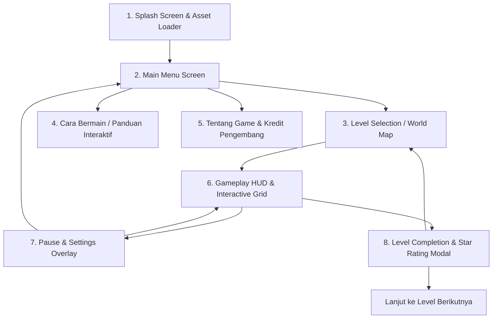

# UI/UX DESIGN SPECIFICATION
# RoboJalur: Ekspedisi Pulau Algoritma

---

## 1. USER EXPERIENCE (UX) ARCHITECTURE & SCREEN FLOW

---

## 2. DETAILED SCREEN SPECIFICATIONS

### Screen 1: Splash Screen & Loading Experience
* **Tujuan:** Pengenalan branding instansi (BBGTK Jawa Tengah) dan judul game saat memuat aset suara dan gambar.
* **Komponen:**
  * Background pemandangan pulau tropis berteknologi dengan kabut lembut.
  * Logo BBGTK Provinsi Jawa Tengah & Logo Game "RoboJalur".
  * Animasi robot Byte meluncur dengan riang di atas progress bar energi baterai.
  * Teks status memuat: *"Menghubungkan ke Satelit Navigasi Pulau..."* -> *"Menyiapkan Modul Logika..."*.
  * Tombol transisi: *"Klik / Sentuh untuk Memulai"* (memenuhi kebijakan browser autoplay audio).

### Screen 2: Main Menu Screen
* **Komponen & Tata Letak:**
  * **Header:** Judul megah *"RoboJalur"* dengan subjudul *"Ekspedisi Pulau Algoritma"*, dilengkapi lencana institusi BBGTK Jawa Tengah.
  * **Hero Visual:** Robot Byte berdiri di atas ubin batu kuno melambaikan tangan dengan efek kedip mata interaktif.
  * **Navigasi Utama (Tombol Aksi Taktil 3D):**
    1. `▶ MULAI EKSPEDISI` (Tombol utama paling menonjol, warna Emerald Green `#10B981`).
    2. `🗺 PILIH LEVEL` (Akses level yang telah terbuka).
    3. `📖 CARA BERMAIN` (Panduan visual kartu algoritma).
    4. `ℹ TENTANG & KREDIT` (Informasi pedagogi & pengembang).
  * **Kontrol Cepat (Pojok Kanan Atas):**
    - Toggle Musik BGM (On/Off)
    - Toggle Efek SFX (On/Off)
    - Tombol Layar Penuh (Fullscreen)

### Screen 3: Gameplay HUD & Command Deck (Screen Inti)
* **Tata Letak Responsif:**
  * **Area Kiri/Tengah (Grid World Canvas, 60–70% lebar layar):**
    - Peta petak ubin dengan Byte, kristal energi, ubin saklar, rintangan tebing/sungai, dan stasiun akhir.
    - Kamera cerdas yang sedikit bergeser dinamis mengikuti posisi Byte.
    - Partikel berkilau saat Byte melangkah atau mengumpulkan kristal.
  * **Area Kanan/Bawah (Command Deck / Rak Koding, 30–40% lebar layar):**
    - **Rak Kartu (Command Palette):** Balok kartu yang tersedia (`MAJU`, `PUTAR KANAN`, `PUTAR KIRI`, `LOMPAT`, `LOOP`). Kartu dapat diklik langsung atau di-drag ke slot.
    - **Antrean Program (Program Sequence Tray):** Deretan slot kotak bernomor (Langkah 1, Langkah 2, dst.) tempat kartu tersusun.
    - **Kontrol Eksekusi:**
      * Tombol Hijau Besar: `▶ JALANKAN PROGRAM`
      * Tombol Oranye: `⏮ RESET / DEBUG`
      * Tombol Abu-abu: `🗑 HAPUS SEMUA`
    - **Indikator Efisiensi Kode:** Menampilkan `Kartu Digunakan: X / Target Par: Y` untuk panduan meraih Bintang 3.

### Screen 4: Level Completion & Victory Modal
* **Komponen:**
  * Kartu dialog mengambang (*floating modal card*) dengan efek kembang api konfeti ramah lingkungan.
  * Skor 3 Bintang dengan animasi pendar bintang bertahap:
    - ⭐ Bintang 1: Stasiun Akhir Tercapai!
    - ⭐ Bintang 2: Semua Kristal Terkumpul!
    - ⭐ Bintang 3: Master Algoritma! (Langkah Efisien)
  * Rincian Data Belajar: Jumlah baris instruksi dan waktu penyelesaian.
  * Tombol Aksi:
    - `🔄 ULANGI LEVEL` (Tantang diri untuk kode lebih ringkas)
    - `▶ LEVEL BERIKUTNYA`
    - `🏠 MENU UTAMA`

### Screen 5: Panduan Interaktif ("Cara Bermain")
* **Komponen:**
  * Carousel kartu mini interaktif yang menjelaskan:
    1. Cara menyusun urutan langkah (*Sequencing*).
    2. Perbedaan Belok Kanan/Kiri dari sudut pandang robot (*Spasial*).
    3. Menggunakan balok *Loop* untuk meringkas langkah berulang.
    4. Menggunakan tombol *Debug* saat terjadi hambatan.

### Screen 6: Layar Tentang Game & Kredit Pengembang
* **Komponen Terstruktur:**
  * **Judul & Versi:** RoboJalur v1.0.0 (2026).
  * **Penyelenggara & Pengembang:**
    - Riskhi Ilham Hidayat — Pengembang Teknologi Pembelajaran.
    - Balai Besar Guru dan Tenaga Kependidikan (BBGTK) Provinsi Jawa Tengah.
  * **Fokus Pedagogis:** Melatih Berpikir Komputasional Siswa SD (Fase B & C).
  * **Apresiasi & Lisensi:** Lisensi Edukasi Berkelanjutan.

---

## 3. DESIGN TOKENS & ATOMIC UI

### A. Dimensi & Target Sentuh (Touch Targets)
* **Tombol Standar:** Tinggi minimal 50px, sudut melengkung `border-radius: 14px`.
* **Kartu Perintah (Command Cards):** Ukuran ideal 72x80px (Desktop) dan 60x70px (Tablet), dilengkapi ikon arah yang besar dan label teks tebal kontras tinggi.
* **Jarak Antar-Elemen (Spacers):** `8px`, `12px`, `16px`, `24px`.

### B. Status Komponen (Component States)
* **Default:** Warna solid cerah, bayangan bawah 3D 4px (`box-shadow: 0 4px 0 #00000030`).
* **Hover:** Sedikit terangkat (`transform: translateY(-2px)`), bayangan membesar 6px, pendaran halus.
* **Active / Pressed:** Turun ke posisi asli (`transform: translateY(3px)`), bayangan menjadi 1px (sensasi klik fisik nyata).
* **Disabled:** Desaturasi 50%, opacity 0.5, kursor `not-allowed`.
* **Executing / Active Trace:** Bingkai kuning bercahaya (*pulsing glow effect*) dan panah penunjuk aktif.
* **Error / Bugged Slot:** Bingkai oranye-merah dengan getaran lembut (*shake animation* 0.3 detik).

---

## 4. KEBIJAKAN ANTI-AI-SLOP (STRICT ANTI-AI-SLOP POLICY)
* **Tanpa Emoji Pengganti Aset:** Semua elemen navigasi menggunakan SVG vector bersih yang dirancang khusus atau ikon berstandar game studio (tidak menggunakan emoji karakter ponsel).
* **Tanpa Ilustrasi Generik Murahan:** Karakter Byte dan aset pulau tropis menggunakan aset ilustrasi nyata berstandar art direction, bukan clipart bebas acak.
* **Tipografi Presisi:** Hierarki teks terukur menggunakan web-font modern (`Outfit` dan `Nunito`), bebas dari teks bawaan browser default (*Times/System Sans*).
